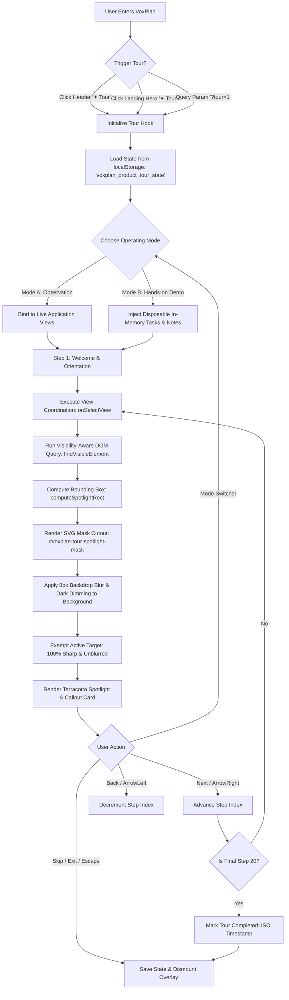

# VoxPlan: Adaptive Productivity & Task-Scheduling Intelligence

[](https://github.com/kanwal-vyas/VoxPlan/actions)
[](https://react.dev/)
[](https://vitejs.dev/)
[](https://fastapi.tiangolo.com/)
[](https://scikit-learn.org/)
[](https://github.com/kanwal-vyas/VoxPlan)
[](https://github.com/kanwal-vyas/VoxPlan)

> **"VoxPlan transforms static task lists into executable calendar plans, evaluating completion risk with supervised machine learning, adapting to individual pacing with empirical Bayesian shrinkage, and guiding users with a browser-native voice and interactive tour experience—all while keeping your data 100% local."**

---

## Live Deployments & Repository

- **GitHub Repository**: [https://github.com/kanwal-vyas/VoxPlan](https://github.com/kanwal-vyas/VoxPlan)
- **Frontend Web Application (Render Static Site)**: [https://voxplan-u31l.onrender.com](https://voxplan-u31l.onrender.com/)
- **Machine Learning API Service (Render Web Service)**: [https://voxplan-api.onrender.com](https://voxplan-api.onrender.com/)
- **Interactive OpenAPI Documentation**: [https://voxplan-api.onrender.com/docs](https://voxplan-api.onrender.com/docs) (or `http://127.0.0.1:8000/docs` locally)

---

## Table of Contents

1. [Executive Overview & Key Highlights](#executive-overview--key-highlights)
2. [Problem Statement & Motivation](#problem-statement--motivation)
3. [Core Design Principles](#core-design-principles)
4. [Complete Feature Inventory](#complete-feature-inventory)
5. [Interactive Product Tour (Phase 8.17 & 8.18)](#interactive-product-tour)
6. [How VoxPlan Works](#how-voxplan-works)
7. [System Architecture](#system-architecture)
8. [Deterministic Adaptive Scheduling Engine](#deterministic-adaptive-scheduling-engine)
9. [Empirical Bayesian Personalization Model](#empirical-bayesian-personalization-model)
10. [Machine Learning Delay-Risk Estimation](#machine-learning-delay-risk-estimation)
11. [Local-First Persistence & Privacy Architecture](#local-first-persistence--privacy-architecture)
12. [Natural Language & Voice Interaction](#natural-language--voice-interaction)
13. [Installation & Developer Setup](#installation--developer-setup)
14. [Testing & Quality Verification](#testing--quality-verification)
15. [Deployment Configuration](#deployment-configuration)
16. [Repository Structure](#repository-structure)
17. [Known Limitations & Future Scope](#known-limitations--future-scope)
18. [Authors & Community](#authors--community)

---

## Executive Overview & Key Highlights

VoxPlan is an adaptive personal planning application designed to solve the rigidity, privacy invasion, and unreliability of modern productivity tools. It pairs **deterministic mathematical scheduling** running locally in the browser with a lightweight **supervised machine learning microservice** that forecasts task delay risk.

### Key Highlights
- **Deterministic DAG Scheduling**: Uses Kahn’s algorithm to topologically sequence tasks based on strict prerequisite dependencies, daily working capacity limits (6.0h/day default), and deadline urgency—without any external cloud solvers.
- **Empirical Bayesian Personalization**: Automatically learns individual estimation pace using statistical shrinkage ($w = \frac{n}{n + 3.0}$) against historical stopwatch tracking, preventing erratic schedule swings on sparse data.
- **Supervised ML Delay Risk**: A Python/FastAPI microservice running scikit-learn `RandomForestClassifier` assesses completion risk and provides plain-English factor explanations.
- **20-Step Interactive Product Tour**: A camera-focused onboarding experience with an SVG mask cutout, 8px backdrop blur, terracotta spotlight highlighting, and two operating modes (Observation vs. Hands-on Demo).
- **100% Local-First Resilience**: Tasks, behavioral telemetry, and notes stay in browser `IndexedDB` (`voxplan_db`) and `localStorage`. Core task management, scheduling, and calendar generation function completely offline.
- **Zero Cloud LLM Dependency**: Natural language processing uses deterministic regex and preposition grammar splitters; voice dictation operates via the browser’s native Web Speech API. Zero audio or task content is sent to third-party AI APIs.
- **Verified Software Quality**: 1,282 frontend unit/integration tests (`npm test`) across 280 suites, 52 dedicated product-tour tests, and 29 backend tests (`pytest`) pass with zero failures.

---

## Problem Statement & Motivation

Traditional task managers and calendar tools suffer from three fundamental architectural flaws:

1. **Static, Non-Adaptive Scheduling**: Conventional apps function as static checklists. When a project overruns or an unexpected dependency blocks work, users must manually calculate and reschedule every dependent task across multiple calendar days.
2. **Privacy Risks & Cloud LLM Hallucinations**: Modern "AI productivity" apps frequently send personal notes, schedules, and voice dictations to third-party cloud APIs (such as OpenAI or Anthropic). This compromises privacy and injects non-deterministic hallucinations into mathematical scheduling constraints.
3. **Fragile Network Dependency**: Cloud-heavy productivity suites fail when network connectivity is lost, leaving users without access to their schedules during travel or network outages.

**VoxPlan's Answer**: Keep user data on the device, solve scheduling deterministically using graph theory, apply machine learning solely for explainable delay risk predictions, and process voice inputs through native browser APIs.

---

## Core Design Principles

| Principle | Architectural Implementation |
|---|---|
| **Local-First by Default** | All tasks, timers, notes, and telemetry are persisted in browser `IndexedDB` (`voxplan_db`) and `localStorage`. No remote database account or cloud authentication is required. |
| **Human Agency (Two-Phase Commit)** | The scheduler never scrambles your live calendar silently. It generates an **Active Proposal** showing a visual diff (original deadline ➜ proposed placement). The user must explicitly inspect and click "Apply Schedule" or "Discard". |
| **Separation of Scheduling & ML** | Machine learning is strictly utilized for **delay risk estimation** (`RandomForestClassifier`). Schedule generation is handled by a deterministic, mathematically verifiable topological DAG solver. |
| **Strict Privacy & Zero Cloud LLM** | No third-party LLM APIs (OpenAI, Anthropic, Gemini). Spoken commands use browser-native Web Speech API. Audio is never stored or streamed to external servers. |
| **Immutable Safety Invariants** | In accordance with Phase 7.4.4B, factory scheduler weights are immutable at runtime (`priority: 100.0`, `urgency: 50.0`, `unblock: 15.0`, `risk: 25.0`) to prevent algorithmic drift. |

---

## Complete Feature Inventory

### 1. Workspace Navigation & Organization
- **Client-Side Routing**:
  - `/` — Product Landing Page & Feature Showcase (lazy-loaded).
  - `/app` — Full operational productivity workspace (lazy-loaded).
- **Four Dedicated Workspace Views**:
  - **Today's Cockpit (`#view-today`)**: High-impact focus tasks for the day, active stopwatch timers, daily capacity status, and quick-add shortcuts.
  - **Tasks Backlog (`#view-tasks`)**: Full task list with priority filters (All, Pending, High Priority, Overdue), manual drag-and-drop or button reordering, inline editing, and deletion with instant undo.
  - **Interactive Calendar (`#view-calendar`)**: Visual multi-day schedule timeline, scheduled task blocks, and RFC 5545 iCalendar (`.ics`) standard export for external sync.
  - **Productivity Insights (`#view-insights`)**: FastAPI model health status, feature importance bars, behavioral habit telemetry, and the Personal Model Dashboard.

### 2. Task Management & Annotation
- **Rich Task Properties**: Title, category, priority (High, Medium, Low), arbitrary due dates, estimated effort hours, dependency prerequisites (`dependsOn`), and completion status.
- **Active Stopwatch Time-Tracking**: Live stopwatch timer on task cards that tracks active focused working seconds across sessions, automatically filtering out paused time.
- **Illustrated Stationery Sticky Notes**: Task-attached digital memo notes with realistic paper tape/pin styling and 6 curated themes:
  - *Classic Yellow*, *Coral Alert*, *Mint Calm*, *Lavender Focus*, *Rose Gold*, and *Blueprint*.
  - Stored locally in `localStorage` under `voxplan_sticky_notes`.
- **Safe Task Deletion & Lossless Undo**: Accidental task deletion displays a persistent floating toast with an "Undo" action that cleanly restores the task at its original list position.

### 3. Proactive Notification Engine
- **Notification Center (`NotificationCenter.jsx`)**: Header bell button with unread counter badge displaying categorized proactive alerts:
  - *Overdue Deadlines*, *Capacity Alerts*, *Dependency Deadlocks*, and *Schedule Recommendations*.
- **Notification Preferences Modal (`NotificationPreferencesModal.jsx`)**: Configurable advance lead times (15m, 1h, 1d), audio chimes, and quiet hours.

### 4. Natural Language & Voice Command Dock
- **CommandBar (`src/components/CommandBar.jsx`)**: Docked command center supporting both typed text and spoken voice commands with identical conversational handling.
- **Preposition Grammar Engine**: Robust compound sentence parsing (e.g., *"Add task Review budget due Friday 3h and mark Invoice as completed"*).
- **Spoken Audio Feedback (TTS)**: Optional speech synthesis debriefing completed operations and schedule changes aloud.
- **Clarification State Machine**: When an action is ambiguous (e.g. multiple tasks sharing a name), VoxPlan displays an interactive candidate selection card rather than executing destructive actions blindly.

---

## Interactive Product Tour

The VoxPlan Interactive Product Tour (**Phase 8.17 & Phase 8.18**) is a core onboarding system that introduces new and returning users to the entire application.



### 1. The 20 Curated Tour Steps

The tour covers all 8 functional domains across 20 sequential steps defined in `src/productTour/tourSteps.js`:

| Step | ID | Domain | Target Element | Primary Concept Demonstrated |
|---|---|---|---|---|
| **1** | `step-orientation` | Orientation | `#header-nav-landing-btn` | Overview page (`/`) vs. Workspace (`/app`) separation. |
| **2** | `step-today-cockpit` | Daily Planning | `#today-focus-card` | Daily sprint focus, urgency badges, stopwatch time tracking. |
| **3** | `step-command-dock` | Commands | `#command` | Natural language command dock for fast keyboard entry. |
| **4** | `step-voice-mic` | Voice & Input | `#voice-mic-btn` | Single-turn Web Speech dictation with live interim transcript. |
| **5** | `step-speech-toggle` | Voice & Input | `#speech-toggle-btn` | Browser speech synthesis toggle for spoken debriefs. |
| **6** | `step-tasks-workspace` | Tasks | `#nav-tab-tasks` | Backlog workspace organization and priority triaging. |
| **7** | `step-smart-filtering` | Tasks | `#task-filter-bar` | Dynamic backlog filtering (All, Pending, High Priority, Overdue). |
| **8** | `step-task-card` | Tasks | `#first-task-card` | Anatomy of a task card: priority cycling, due dates, effort hours. |
| **9** | `step-sticky-notes` | Stationery | `#first-task-sticky-trigger` | Illustrated stationery sticky notes and 6 color themes. |
| **10** | `step-safe-deletion` | Tasks | `#first-task-delete-btn` | Safe task deletion with global floating undo toast. |
| **11** | `step-calendar-view` | Planning | `#nav-tab-calendar` | Calendar timeline visualization and multi-day scheduled blocks. |
| **12** | `step-export-ics` | Planning | `#calendar-export-btn` | Standards-compliant RFC 5545 `.ics` export for external calendars. |
| **13** | `step-adaptive-scheduler` | Scheduling | `#btn-open-schedule-modal` | Kahn's DAG topological solver and capacity packing. |
| **14** | `step-schedule-modal` | Scheduling | `#btn-open-schedule-modal` | Schedule proposal review modal and diff inspection. |
| **15** | `step-insights-view` | Intelligence | `#nav-tab-insights` | ML intelligence panel, backend connectivity, and feature weights. |
| **16** | `step-risk-explanation` | Intelligence | `#view-insights` | Task delay risk explainability modal and plain-English factors. |
| **17** | `step-personal-model` | Personalization | `.personal-model-card` | Empirical Bayesian duration shrinkage ($w = \frac{n}{n + 3.0}$). |
| **18** | `step-adaptation-gate` | Governance | `#adaptation-gate-status` | Phase 7.4.4B permanently locked adaptation gate invariant. |
| **19** | `step-notification-bell` | Notifications | `#header-notification-bell-btn` | Proactive alert notification center and category filters. |
| **20** | `step-graduation` | Graduation | `#header-tour-btn` | Tour completion summary and how to restart anytime. |

### 2. Optical Spotlight Architecture & Visual Isolation (Phase 8.18)

Earlier overlay approaches placed a generic darkened layer over the entire screen, making highlighted targets blurry and hard to read. Phase 8.18 overhauled this with an **SVG Mask Clear-Window Cutout**:

1. **SVG Mask Definition (`TourOverlay.jsx`)**:
   - An SVG `<mask id="voxplan-tour-spotlight-mask">` covers the viewport.
   - When a target element is located, an SVG `<rect>` with fill `black` is punched out at the exact bounding box of the target (plus 8px padding, matching the target’s dynamic border-radius).
2. **Backdrop Blur & Dimming (`ProductTour.css`)**:
   - The `.voxplan-tour-backdrop` element applies `mask: url(#voxplan-tour-spotlight-mask)`.
   - The backdrop uses `backdrop-filter: blur(8px)` and a dark overlay `rgba(32, 30, 35, 0.62)`.
   - **Result**: The active interface target remains **100% sharp, vibrant, and unblurred**, while the rest of the application is dimmed and blurred out of focus.
3. **Terracotta Spotlight Highlighting (`TourSpotlight.jsx`)**:
   - Outlines the active element with a 2.5px solid warm terracotta border (`#C85A32`), outer/inner white hairlines (`rgba(255, 255, 255, 0.9)`), and a warm glow (`box-shadow: 0 0 20px rgba(200, 90, 50, 0.45)`).
   - A docked `"✦ Target"` beacon tag anchors directly to the spotlight border.

### 3. Visibility-Aware Target Resolution

Complex single-page applications mount inactive views in the DOM that can cause element selector collisions. VoxPlan's tour engine resolves targets using `findVisibleElement()`:
- Splits selector lists and checks each candidate node.
- Validates that `rect.width > 0 && rect.height > 0`, ignoring unrendered elements in hidden tabs.
- Incorporates a 240ms settle timer after view transitions to accommodate tab slide animations (`viewEnter 0.18s ease-out`).
- Falls back gracefully to a centered callout card if a target element is not present.

### 4. Two Operating Modes & Data Safety

- **Mode A (Guided Observation)**:
  - Explores the user’s real workspace without creating, editing, or deleting any data.
- **Mode B (Hands-on Practice Demo)**:
  - Injects disposable, in-memory sample tasks and sticky notes (`demoTasks`, `demoNotes`).
  - Users can click checkboxes, delete demo tasks, and test features without affecting real tasks.
  - Resetting or leaving the tour discards the demo state from memory.
- **Strict Isolation Guarantee**:
  - Tour progress is saved exclusively under `localStorage.getItem('voxplan_product_tour_state')`.
  - Real user tasks (`voxplan_tasks`), notifications (`voxplan_notifications`), and notes (`voxplan_task_sticky_notes`) are never modified by the tour.

### 5. Tour Controls & Keyboard Accessibility

- **Forward Navigation**: Click "Next Step →" or press `ArrowRight`.
- **Backward Navigation**: Click "← Back" or press `ArrowLeft`.
- **Dismissal / Exit**: Click the "✕" button or press `Escape` (remembers your last step).
- **Restart**: Click "Restart Tour" on the graduation step or click the header `✦ Tour` button.
- **Reduced Motion**: Respects `@media (prefers-reduced-motion: reduce)` by disabling spotlight animations and transitions.

---

## How VoxPlan Works

```
1. USER ENTERS TASKS
   ├── Via Text / Click (TaskFormModal / QuickAdd)
   └── Via Voice Dictation (Web Speech API -> compoundCommandParser.js)
           ↓
2. TASKS SAVED TO LOCAL INDEXEDDB (voxplan_db)
   ├── Task metadata: effort hours, priority, deadlines, dependencies
   └── Lifecycle tracking: stopwatch timers, completions, reschedules
           ↓
3. DETERMINISTIC ADAPTIVE SCHEDULING (adaptiveScheduler.js)
   ├── Resolves dependencies via Kahn's Topological Sort (DAG)
   ├── Ranks tasks with Composite Priority Formula
   ├── Adjusts duration using Empirical Bayesian Shrinkage (personalModel.js)
   └── Packs into daily working capacity bins (default 6.0h/day)
           ↓
4. SCHEDULE PROPOSAL GENERATED (Two-Phase Commit)
   ├── User inspects proposed dates and unblocking gains in Modal diff
   ├── User clicks "✓ Apply Schedule" -> updates tasks in IndexedDB
   └── User clicks "✕ Discard" -> leaves existing tasks untouched
           ↓
5. SUPERVISED ML RISK FORECASTING (FastAPI + scikit-learn)
   ├── Backend computes Delay Probability [0.0 - 1.0] and Risk Category
   └── User clicks "view details →" to inspect contributing delay factors
```

---

## System Architecture

VoxPlan follows a **local-first frontend architecture** coupled with an optional **FastAPI machine learning microservice**:

```
+---------------------------------------------------------------------------------------+
|                                    CLIENT BROWSER                                     |
|                                                                                       |
|  +--------------------+   +-----------------------+   +----------------------------+  |
|  | Web Speech API     |   | PWA Service Worker    |   | Keyboard & Focus Nav       |  |
|  | (In-browser STT)   |   | (public/sw.js cache)   |   | (WCAG 2.2 AA Accessible)   |  |
|  +--------------------+   +-----------------------+   +----------------------------+  |
|                                         │                                             |
|                                         ▼                                             |
|  +---------------------------------------------------------------------------------+  |
|  |                      REACT 19 + VITE FRONTEND APPLICATION                       |  |
|  |                                                                                 |  |
|  |  [ Client-Side Router: / (LandingPage) & /app (ProductivityApp) ]               |  |
|  |  ├── Product Tour Engine (useProductTour, SVG Mask Spotlight, 20 Steps)         |  |
|  |  ├── Task Backlog & Kanban Cards (TaskCard, Stopwatch Timer, Lossless Undo)     |  |
|  |  ├── Command Dock & Voice Engine (CommandBar, dialogueManager, Preposition NLP) |  |
|  |  ├── Illustrated Stationery Sticky Notes (6 Themes, LocalStorage)               |  |
|  |  ├── Proactive Notification System (NotificationCenter, NotificationBell)       |  |
|  |  ├── Calendar & Time-Blocking (TaskCalendar, RFC 5545 .ics Exporter)            |  |
|  |  └── Intelligence Dashboard (MLModelPanel, BehavioralHistoryPanel)              |  |
|  |                                                                                 |  |
|  |  [ Core Deterministic Scheduling Engine (src/scheduler/adaptiveScheduler.js) ] |  |
|  |  ├── Kahn's Algorithm DAG Topological Sorter (Cycle Detection)                  |  |
|  |  ├── Composite Priority Scorer (100*Prio + 50*Urg + 15*Unblock + 25*Risk)      |  |
|  |  ├── Daily Capacity Bin-Packer (6.0h/day default + Multi-Day Chunking)          |  |
|  |  └── Two-Phase Commit Proposal Generator (Diff Review -> Apply/Discard)         |  |
|  |                                                                                 |  |
|  |  [ Personal Duration Estimator (src/telemetry/personalModel.js) ]               |  |
|  |  ├── Weighted Median Observed Pace Ratio                                        |  |
|  |  ├── Empirical Bayesian Shrinkage (k = 3.0 toward neutral 1.0 prior)            |  |
|  |  └── Learning Readiness Gate (Threshold n >= 3 completions)                    |  |
|  +---------------------------------------------------------------------------------+  |
|                   │                                               │                   |
|                   ▼                                               ▼                   |
|  +----------------------------------+            +---------------------------------+  |
|  |  INDEXEDDB STORE (voxplan_db)    |            |  LOCALSTORAGE STORE             |  |
|  |  - tasks (Full task entities)    |            |  - voxplan_sticky_notes (Memos) |  |
|  |  - telemetry_events (Stopwatch,  |            |  - voxplan_product_tour_state   |  |
|  |    completions, reschedules)     |            |  - User preferences             |  |
|  +----------------------------------+            +---------------------------------+  |
+---------------------------------------------------------------------------------------+
                                    │ (HTTP REST JSON)
                                    ▼ (Optional / Graceful Offline Fallback)
+---------------------------------------------------------------------------------------+
|                          PYTHON 3.12 / FASTAPI ML BACKEND                             |
|                                                                                       |
|  [ REST API Endpoints: backend/main.py ]                                              |
|  ├── GET  /health                   -> Healthcheck and service uptime                 |
|  ├── GET  /api/model/status         -> Model accuracy, sample count, training time    |
|  ├── POST /api/predict & /batch     -> Delay probability [0.0 - 1.0] and risk factors |
|  ├── POST /api/train                -> Retrains model on reference/telemetry data     |
|  └── GET  /api/feature-importance   -> Gini importance metrics                        |
|                                                                                       |
|  [ Machine Learning Pipeline ]                                                        |
|  ├── scikit-learn RandomForestClassifier (Estimating task delivery delay risk)        |
|  └── Rule-based explainability engine (Translates feature weights to plain English)   |
+---------------------------------------------------------------------------------------+
```

---

## Deterministic Adaptive Scheduling Engine

- **Source File**: `src/scheduler/adaptiveScheduler.js`
- **Primary Function**: `generateScheduleProposal(tasks, events, config)`

The scheduler is **not** an opaque machine learning model. It is a deterministic constraint-satisfaction solver:

### 1. Kahn’s Topological Sort on Task Dependencies
Tasks can specify prerequisite tasks via their `dependsOn` property. The scheduler builds an adjacency list and in-degree map:
- Tasks with `inDegree === 0` are placed in the ready queue.
- When a task is placed, its dependents' in-degrees are decremented.
- Includes a 3-color Depth-First Search (DFS) cycle-detection guard to isolate circular dependencies without crashing.

### 2. Composite Priority Scoring Function
Tasks in the ready queue are ordered using a fixed linear scoring formula:
$$\text{Score} = (100.0 \times P) + (50.0 \times U) + (15.0 \times B) + (25.0 \times R)$$

Where:
- $P \in \{1, 2, 3\}$: Priority level (`low` = 1, `medium` = 2, `high` = 3).
- $U \in [0.0, 1.0]$: Urgency ratio based on calendar proximity to deadline.
- $B \in [0, 3]$: Bounded downstream unblocking bonus ($+\min(45, 15 \times \text{dependents})$), prioritizing tasks that unblock subsequent work.
- $R \in [0.0, 1.0]$: Delay risk probability from the ML backend.

> **Immutable Security Invariant (Phase 7.4.4B)**: Factory weights are strictly frozen at runtime (`100.0, 50.0, 15.0, 25.0`). Dynamic weight tuning is locked to ensure reproducible, predictable scheduling behavior.

### 3. Daily Capacity Bin-Packing
- Tasks are packed into consecutive working weekdays up to a configured daily maximum (default `6.0h/day`).
- **Oversized Task Handling**: Tasks exceeding daily capacity are either split across multiple working sessions (`taskChunker.js`) or flagged for user review.
- Weekends and configured meeting blocks are automatically skipped.

### 4. Two-Phase Commit Proposal Review
Schedule output is returned as an immutable proposal diff. The user reviews original deadlines against proposed dates in `AdaptiveScheduleModal.jsx` before changes are committed to `IndexedDB`.

---

## Empirical Bayesian Personalization Model

- **Source File**: `src/telemetry/personalModel.js`
- **Primary Function**: `buildPersonalDurationModel(events)`

VoxPlan personalizes task duration estimates locally using empirical Bayesian statistics:

### 1. Duration Accounting
When a user completes a task, duration is classified strictly by evidence quality:
- **`tracked`** ($w = 1.0$): Measured accurately via the live stopwatch timer.
- **`self_reported`** ($w = 0.5$): User-entered estimate upon completion.
- **`unknown`** ($w = 0.0$): Unmeasured completions are excluded from ratio calculations.

### 2. Empirical Bayesian Shrinkage Formula
For category $i$, observed pace ratios are calculated as $r = \frac{\text{actual duration}}{\text{estimated effort}}$. The model calculates the weighted median observed ratio $\bar{r}_i$ and shrinks it toward a neutral prior ($1.0$):

$$w_i = \frac{N_i}{N_i + K}$$

$$r_{\text{adjusted}} = w_i \bar{r}_i + (1 - w_i) \times 1.0$$

Where:
- $N_i$: Total effective completed task weight in category $i$.
- $K = 3.0$: Shrinkage parameter representing prior confidence strength.

### 3. Learning Readiness Gate
To prevent premature or erratic duration shifts on sparse data:
- If effective completions $N < 3.0$, the model remains in **`sparse`** or **`cold_start`** mode, returning the user’s original estimate unmodified.
- Once $N \ge 3.0$, conservative shrinkage activates, displaying the adjusted estimate and sample count on task cards (e.g. `⏱️ 2h → ~2.5h (4)`).

---

## Machine Learning Delay-Risk Estimation

- **Source File**: `backend/main.py`
- **Model Framework**: scikit-learn `RandomForestClassifier`

### 1. Role & Boundaries
Machine learning in VoxPlan is strictly used for **delay risk estimation**, not schedule optimization. It evaluates whether a task is likely to miss its deadline given historical indicators.

### 2. Evaluated Features
1. **Estimated Effort**: Planned duration in hours.
2. **Priority Weight**: Numerical priority encoding.
3. **Calendar Lead Time**: Days remaining until the deadline.
4. **Dependency Depth**: Distance from root in the prerequisite DAG.
5. **Historical Category Delay Ratio**: Prior overdue frequency for similar tasks.

### 3. API Endpoints

| Method | Endpoint | Description |
|---|---|---|
| `GET` | `/health` | Healthcheck returning `{ "status": "ok", "service": "voxplan-ml" }` |
| `GET` | `/api/model/status` | Model training status, sample count, accuracy, and timestamp |
| `POST` | `/api/predict` | Single-task delay probability $[0.0, 1.0]$ and categorical risk (`LOW`, `MEDIUM`, `HIGH`) |
| `POST` | `/api/predict/all` | Batch inference across multiple tasks |
| `POST` | `/api/train` | Retrains model on reference dataset or telemetry |
| `GET` | `/api/feature-importance` | Returns Gini importance scores across predictors |

### 4. Graceful Offline Fallback
If the FastAPI backend is offline or unreachable:
- The frontend status pill in the header displays `"Offline"`.
- The scheduler automatically uses a local deterministic heuristic risk baseline.
- Full task management, scheduling, sticky notes, and calendar export continue operating with zero data loss or application crashes.

---

## Local-First Persistence & Privacy Architecture

### 1. Client Storage Layers
- **IndexedDB (`voxplan_db`)**:
  - `tasks`: Full structured task objects, priorities, dependencies, and timestamps.
  - `telemetry_events`: Immutable audit trail of completions, stopwatch intervals, and reschedules.
- **localStorage**:
  - `voxplan_sticky_notes`: Task memo notes across 6 stationery themes.
  - `voxplan_product_tour_state`: Tour completion flags, step index, and operating mode.
  - User notification preferences and theme settings.
- **PWA Service Worker (`public/sw.js`)**:
  - Implements a cache-first strategy for static application assets (HTML, CSS, JS, fonts).
  - Enables standalone offline installability on desktop and mobile.

### 2. Privacy Guarantees
- **No Third-Party Cloud LLMs**: Task details, personal notes, and voice transcripts are never transmitted to external AI providers.
- **Local Audio Processing**: Voice recognition runs through the client browser's Web Speech API implementation.
- **Encrypted Workspace Backup**: Built-in client-side AES-GCM (256-bit) encryption allows users to export and restore their complete workspace with password protection (`src/components/BackupModal.jsx`).

---

## Natural Language & Voice Interaction

- **Source Files**: `src/components/CommandBar.jsx`, `src/conversation/dialogueManager.js`, `src/conversation/compoundCommandParser.js`

### Supported Natural Language Commands

```text
# Task Creation & Priority
"Add task Prepare Presentation due Friday 3h"
"Create a high priority task Infrastructure Audit due 2026-11-15"
"New task Draft project report with low priority"

# Task Lifecycle & Status
"Mark Prepare Presentation as completed"
"Uncomplete Prepare Presentation"
"Delete Infrastructure Audit"
"Clear completed tasks"

# Scheduling & Planning
"Plan sprint"
"Optimize schedule"
"Spread tasks across next 3 days"

# Predictive Intelligence Queries
"Show high risk tasks"
"Explain project risk"
"How did my plan go?"
"Train the model"
```

### Conversational Safeguards
- **Compound Splitting**: Sentences containing multiple instructions (e.g. *"Create task Alpha, and mark Beta as done"*) are split and processed sequentially.
- **Disambiguation**: If an action targets a name shared by multiple tasks, VoxPlan displays a clarification modal asking the user to choose the intended task.
- **Confirmation for Destructive Actions**: Deleting tasks or clearing history requires explicit confirmation.

---

## Installation & Developer Setup

### Prerequisites
- **Node.js**: v18.0.0 or higher (v20+ recommended)
- **Python**: 3.10, 3.11, 3.12, or 3.13
- **Git**

---

### Step 1: Clone the Repository

```bash
git clone https://github.com/kanwal-vyas/VoxPlan.git
cd VoxPlan
```

---

### Step 2: Configure Environment Variables

Copy the example template to create your local `.env`:

```bash
cp .env.example .env
```

Default `.env` contents for local development:
```ini
# Frontend: URL of the local FastAPI backend
VITE_API_BASE_URL=http://127.0.0.1:8000

# Backend: Local host and port
HOST=127.0.0.1
PORT=8000
CORS_ORIGINS=*
ENVIRONMENT=development
```

---

### Step 3: Start the Backend (Terminal 1)

```bash
# 1. Create a Python virtual environment
python -m venv .venv

# 2. Activate the virtual environment
# On Windows (PowerShell):
.venv\Scripts\Activate.ps1
# On Windows (Command Prompt):
.venv\Scripts\activate.bat
# On macOS / Linux:
source .venv/bin/activate

# 3. Install backend dependencies
pip install -r backend/requirements.txt

# 4. Start the FastAPI ASGI server
python -m uvicorn backend.main:app --host 127.0.0.1 --port 8000 --reload
```

The backend is now live at `http://127.0.0.1:8000`. You can inspect the interactive Swagger API documentation at `http://127.0.0.1:8000/docs`.

---

### Step 4: Start the Frontend (Terminal 2)

```bash
# 1. Install frontend npm dependencies
npm install

# 2. Start the Vite development server
npm run dev
```

Open your browser to `http://localhost:5173`.
- Visit `http://localhost:5173/` for the **Product Landing Page**.
- Visit `http://localhost:5173/app` for the **Productivity Application Workspace**.
- Visit `http://localhost:5173/app?tour=1` to launch the **Interactive Product Tour** directly.

---

### Automated Multi-Service Launchers

For convenience, VoxPlan provides an automated launch script that checks ports, verifies dependencies, starts both services, and opens the browser:

```bash
# Cross-platform Node.js launcher
npm run demo              # Launches services and opens Landing Page (/)
npm run demo -- --app     # Launches services and opens Workspace (/app)
npm run demo -- --no-open # Launches services without opening the browser
npm run demo -- --dry-run # Performs port and dependency preflight check only

# On Windows:
.\run-demo.bat
.\run-demo.bat --app
```

---

## Testing & Quality Verification

VoxPlan enforces strict quality gates across both frontend and backend suites.

```bash
# 1. Run Complete Frontend Test Suite (Node.js test runner)
npm test
# Verified result: 1,282 passing tests across 280 suites (0 failures)

# 2. Run Dedicated Product Tour Test Suite
node --test tests/product_tour/product_tour.test.js
# Verified result: 52 passing tests across 9 suites (0 failures)

# 3. Run Backend Test Suite (Pytest)
python -m pytest backend/tests/ -v
# Verified result: 29 passing tests across date handling and ML routes (0 failures)

# 4. Run Fast Linter Check (Oxlint)
npm run lint
# Verified result: 0 errors

# 5. Compile Production Bundle (Vite)
npm run build
# Verified result: Clean build with code-splitting in < 1s

# 6. Run Secret & Credential Exposure Scanner
node scripts/secretScanner.mjs
# Verified result: 0 secrets detected across repository
```

---

## Deployment Configuration

VoxPlan is configured for deployment on **Render**:

| Service | Render Service Type | Environment / Build Command | Publish / Start Command | Live URL |
|---|---|---|---|---|
| **`VoxPlan`** | Static Site | `npm install && npm run build` | `dist/` | `https://voxplan-u31l.onrender.com` |
| **`voxplan-api`** | Web Service | `pip install -r backend/requirements.txt` | `uvicorn backend.main:app --host 0.0.0.0 --port $PORT` | `https://voxplan-api.onrender.com` |

### Critical Render Static Site Configuration: SPA Rewrite Rule
Because VoxPlan is a single-page application utilizing client-side routing (`/` and `/app`), direct page visits or browser reloads on `/app` require a rewrite rule in the Render dashboard:
- **Type**: `Rewrite`
- **Source**: `/*`
- **Destination**: `/index.html`

*Physical assets (`/assets/*`, `/favicon.svg`, `/manifest.webmanifest`, `/sw.js`) continue to be served directly from disk with priority.*

---

## Repository Structure

```text
VoxPlan/
├── backend/
│   ├── main.py                     # FastAPI application, CORS, REST endpoints & ML routes
│   ├── requirements.txt            # Python dependencies (FastAPI, scikit-learn, pydantic)
│   ├── ml/
│   │   ├── data_generator.py       # Reference baseline dataset generator
│   │   ├── features.py             # Feature extraction & calendar date parsing
│   │   ├── train.py                # RandomForest training & evaluation pipeline
│   │   ├── predict.py              # Delay risk inference & factor signal extraction
│   │   └── model.py                # Pydantic schemas (TaskInput, PredictionOutput)
│   ├── models/                     # Serialized model artifacts (.joblib, metadata.json)
│   └── tests/
│       ├── test_date_handling.py   # 18 unit tests for calendar dates & timezone logic
│       └── test_ml_backend.py      # 11 unit tests for FastAPI endpoints & prediction
│
├── public/
│   ├── favicon.svg                 # Canonical warm yellow rounded square with sparkle badge
│   ├── favicon.ico                 # Multi-size fallback favicon (16x16, 32x32, 48x48)
│   ├── manifest.webmanifest        # W3C PWA web application manifest
│   ├── sw.js                       # PWA Service Worker implementing offline app shell cache
│   └── brand-icons/                # High-res PWA raster icons (192x192, 512x512, maskable)
│
├── src/
│   ├── api/
│   │   └── mlApi.js                # HTTP client for backend communication with offline guards
│   ├── components/
│   │   ├── Header.jsx              # Application navigation, status pill, and tour trigger
│   │   ├── Hero.jsx                # Landing hero with editorial typography & preview cards
│   │   ├── CommandBar.jsx          # Voice and typed command dock with interim transcript
│   │   ├── ProjectOverview.jsx     # Sprint health overview & adaptive schedule trigger
│   │   ├── TaskList.jsx            # Task filtering, priority pills, and sorting controls
│   │   ├── TaskCard.jsx            # Stopwatch timer, inline edit, memo tab, and risk badge
│   │   ├── TaskCalendar.jsx        # Calendar view, time-blocked grid, and .ics export
│   │   ├── TaskExplanationModal.jsx # ML delay risk explainability modal with plain-English factors
│   │   ├── AdaptiveScheduleModal.jsx # Adaptive schedule proposal diff review modal
│   │   ├── BehavioralHistoryPanel.jsx # Focus habits, velocity trends, and telemetry controls
│   │   ├── PersonalModelDashboard.jsx # Bayesian shrinkage duration model & evaluation
│   │   ├── LearningReadinessPanel.jsx # Learning readiness gate indicators (n >= 3 threshold)
│   │   ├── FeedbackToast.jsx       # Floating global feedback toast with lossless undo
│   │   ├── BackupModal.jsx         # AES-GCM encrypted workspace export and restore
│   │   ├── notifications/          # Proactive notification bell, center, and settings modals
│   │   ├── stickyNotes/            # Illustrated stationery sticky notes modal and 6 themes
│   │   └── productTour/            # Scoped Product Tour overlay, spotlight, and callout components
│   │
│   ├── productTour/
│   │   ├── tourSteps.js            # Authoritative 20-step curated tour inventory
│   │   ├── useProductTour.js       # Hook managing tour state, SVG spotlight bounds, and keyboard nav
│   │   ├── tourStorage.js          # Isolated storage helper ('voxplan_product_tour_state')
│   │   ├── demoState.js            # Disposable in-memory demo data for hands-on practice (Mode B)
│   │   └── positionHelper.js       # Spotlight geometry calculations & viewport boundary clamping
│   │
│   ├── scheduler/
│   │   ├── adaptiveScheduler.js    # Deterministic Kahn DAG topological solver & capacity packer
│   │   ├── taskChunker.js          # Multi-day task session chunking for oversized work
│   │   ├── timeBlockScheduler.js   # Intraday focus windows and meeting buffer constraints
│   │   ├── proposalEditor.js       # Manual placement overrides on draft proposals with undo
│   │   ├── icalExporter.js         # RFC 5545 iCalendar standard .ics generator
│   │   └── activationGateEvaluator.js # Security gate enforcing locked Stage 7.4.4B invariants
│   │
│   ├── telemetry/
│   │   ├── eventSchema.js          # Schema v2 typed behavioral event definitions
│   │   ├── indexedDbStore.js       # Local-first IndexedDB wrapper ('voxplan_db')
│   │   ├── taskLifecycle.js        # Shared task lifecycle engine & stopwatch finalization
│   │   ├── personalModel.js        # Weighted median & empirical Bayesian duration shrinkage
│   │   └── telemetryManager.js     # Client profile manager, timer persistence & event logger
│   │
│   ├── conversation/
│   │   ├── speechEngine.js         # Web Speech API recognition & speech synthesis controller
│   │   ├── dialogueManager.js      # Multi-turn conversation state machine & confirmations
│   │   └── compoundCommandParser.js # Deterministic preposition-based natural language parser
│   │
│   ├── pages/
│   │   ├── LandingPage.jsx         # Product overview & feature preview route ('/')
│   │   └── ProductivityApp.jsx     # Operational task planning workspace route ('/app')
│   │
│   ├── utils/
│   │   ├── pwaManager.js           # Service worker registration and PWA install prompt handler
│   │   ├── stickyNotesStorage.js   # LocalStorage persistence for illustrated sticky notes
│   │   └── demoDataSeeder.js       # Deterministic 12-task showcase seeding and clean teardown
│   │
│   ├── App.jsx                     # Top-level client router and error boundary
│   └── main.jsx                    # React 19 entry point
│
├── tests/                          # 1,282 automated unit, integration, and regression tests
│   ├── product_tour/               # 52 dedicated product tour tests across 9 suites
│   ├── scheduler.test.js           # Kahn DAG sort, capacity packing, unblocking bonuses
│   ├── personal_model.test.js      # Bayesian duration shrinkage and readiness gates
│   ├── voice_dialogue.test.js      # Compound preposition parsing and Web Speech states
│   └── components.test.jsx         # Accessibility, modal keyboard traps, and design tokens
│
├── ppt_assets/                     # Presentation assets (12 genuine screenshots, architecture diagram)
├── scripts/
│   ├── demoLauncher.mjs            # Cross-platform demo orchestrator with port probes
│   ├── secretScanner.mjs           # Recursive credential scanner for git hooks and CI
│   └── generateBrandFavicons.py    # Generates multi-size brand favicons and PWA rasters
│
├── .env.example                    # Template environment configuration
├── Dockerfile                      # Non-root multi-stage production container
├── PROJECT_PLAN.md                 # Authoritative historical engineering phases
├── PROJECT_SCOPE.md                # Authoritative scope boundaries (Categories A-F)
├── package.json                    # Dependencies, scripts, and project metadata
└── README.md                       # Comprehensive project documentation
```

---

## Known Limitations & Future Scope

### Known Limitations (Honest Technical Disclosures)
1. **Single-Device Local Persistence**: Because tasks, telemetry, and sticky notes are stored in client-side `IndexedDB` and `localStorage`, data does not automatically synchronize across different browsers or devices without using the manual encrypted backup feature (`BackupModal.jsx`).
2. **Speech Recognition Browser Variability**: Web Speech API speech-to-text relies on native browser support. It operates with high accuracy in Chromium-based browsers (Google Chrome, Microsoft Edge, Brave) and Safari, but has limited support in Mozilla Firefox. Typed input in the command dock serves as an identical, fully functional fallback.
3. **ML Microservice Cold-Start**: On free-tier cloud deployments (such as Render free web services), the backend API may take 30–50 seconds to spin up from an idle state. During this time, the frontend operates seamlessly offline, using its deterministic heuristic baseline.

### Future Scope (Genuinely Not Yet Implemented)
- **Peer-to-Peer Encrypted Device Sync**: Implementing local-first WebRTC / CRDT synchronization between desktop and mobile devices without requiring a centralized cloud database.
- **Bi-directional CalDAV Synchronization**: Two-way live synchronization with Google Calendar, Nextcloud, and Outlook via the CalDAV protocol, extending the current one-way RFC 5545 `.ics` export.
- **On-Device Small Language Model (SLM)**: Running lightweight WebAssembly-compiled local language models (such as WebLLM / Gemma 2B) directly in the browser to expand conversational query capabilities without external API dependencies.

---

## Authors & Community

- **Creator & Lead Developer**: Kanwal Vyas ([GitHub](https://github.com/kanwal-vyas))
- **Repository**: [https://github.com/kanwal-vyas/VoxPlan](https://github.com/kanwal-vyas/VoxPlan)
- **Live Application**: [https://voxplan-u31l.onrender.com](https://voxplan-u31l.onrender.com/)
